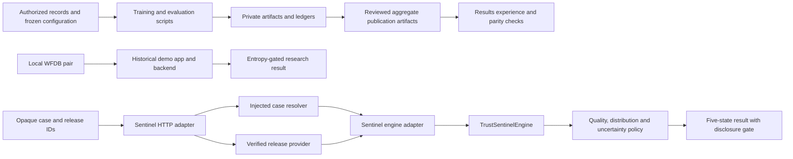

# Architecture and change guide

ECG Trust Lab contains three distinct execution paths: offline scientific
experiments, a local historical-model demo, and the developing Sentinel trust
service. The public results website renders aggregate evidence. Treating these
as one deployable product would hide important differences in their evidence
and runtime requirements.

## Runtime paths

The Sentinel path describes implemented interfaces and composition, not a
validated deployment or a ready-to-run real-data server. Its current execution
and evidence gaps are in [known limitations](KNOWN_LIMITATIONS.md). The local
demo does not become a Sentinel release by sharing classes or vocabulary.

## Where a change belongs

| Responsibility | Start here | Preserve |
|---|---|---|
| Data identity, task manifest and normalization | [data](../src/ecg_trust/data/), [protocol](../src/ecg_trust/protocol.py) | Patient isolation, train-only fitting and exact task/lead order |
| Model construction and training | [models](../src/ecg_trust/models/), [training](../src/ecg_trust/training.py) | Frozen model/config compatibility and deterministic controls |
| Experiment orchestration | [sweep runner](../src/ecg_trust/sweep_runner.py), [multiseed runner](../src/ecg_trust/multiseed_runner.py), [refit runner](../src/ecg_trust/refit_runner.py) | Search/selection/refit role separation and immutable run history |
| Final evidence and publication | [final batch](../src/ecg_trust/final_batch.py), [post evaluation](../src/ecg_trust/post_evaluation.py), [final results](../src/ecg_trust/final_results.py) | One-shot ledgers, parent hashes, failed/superseded artifacts |
| Research metrics | [evaluation](../src/ecg_trust/evaluation.py), [toolkit guide](EVALUATION_TOOLKIT.md) | Estimands, numerical validation and descriptive-versus-fitted distinction |
| Artifact identity and release integrity | [registry](../src/ecg_trust/registry/), [runtime binding](../src/ecg_trust/runtime_binding.py) | Exact parent roles, fresh integrity checks and private paths |
| Five-state orchestration | [Sentinel engine](../src/ecg_trust/sentinel_engine.py), [trust policy](../src/ecg_trust/trust_policy.py) | Gate order, unavailable-component behavior and prediction withholding |
| Service contracts and HTTP | [service](../src/ecg_trust/service/), public factory `service.sentinel_service.create_sentinel_app` | Opaque identifiers, safe errors, release coherence, idempotency and capacity limits |
| Local historical demo | [demo app](../src/ecg_trust/demo_app.py), [demo backend](../src/ecg_trust/demo_backend.py) | WFDB validation, local-only scope, abstention disclosure and temporary-file lifetime |
| Controlled failure experiments | [Failure Lab](../src/ecg_trust/failure_lab.py), [stress scenarios](../src/ecg_trust/stress/scenarios.py) | Deterministic transforms and synthetic-only public trial export |
| Operational evidence | [audit log](../src/ecg_trust/audit_log/), [monitoring](../src/ecg_trust/monitoring/) | Privacy, append/integrity rules and explicit thresholds |
| Public result presentation | [results experience](../results-experience/README.md) | Parity with sealed aggregates and visible limitations |

## Existing seams worth keeping

`CaseResolver` owns access to authorized cases; `VerifiedReleaseProvider` owns
release verification; `AnalysisEngine` owns the decision computation. The HTTP
module accepts these dependencies rather than constructing storage or models.
Keep implementations behind those existing interfaces instead of introducing a
generic service framework.

`TrustSentinelEngine.from_verified_bundle` loads components through explicit
loaders and binds them to verified parent roles. A new detector or quality policy
must not bypass that binding or imply that a development preset is a promoted
release. Read the applicable protocol before changing the loading path.

Metrics return research results; runners own files, ledgers and execution order.
When extracting code, preserve that distinction. A utility that merely forwards
arguments across several files adds work for readers without centralizing a real
responsibility.

## Refactor priorities

1. Separate HTTP-independent contracts from route orchestration so storage and
   engine adapters can reuse them without importing the web framework.
2. Give replay coordination one owner. Keep pending flights, conflicts, eviction
   and failure retries together, with their concurrency tests.
3. Keep upload containment and bounded reading together, while leaving temporary
   directory ownership and inference scheduling in the app.
4. Inspect large scientific runners by responsibility before moving code.
   Extract pure planning/validation from execution only when callers and tests
   show a useful seam. File length alone does not justify a rewrite.

Use existing behavior tests across the interface. For a mechanical move, compare
the moved definitions, old import identities and relevant serialized outputs
before/after. For HTTP changes, compare generated schemas and exercise successful,
refused and unavailable responses. For a defect, first record a reproducible
failure and a valid control. See [CONTRIBUTING](../CONTRIBUTING.md).

## What engineering verification cannot prove

CPU tests cannot reproduce private Windows/CUDA scientific runs. A clean import,
wheel build, synthetic scenario or HTTP test does not validate a new model,
cohort, threshold or clinical claim. Preserve frozen artifacts and record the
revision and environment used for every engineering result.
